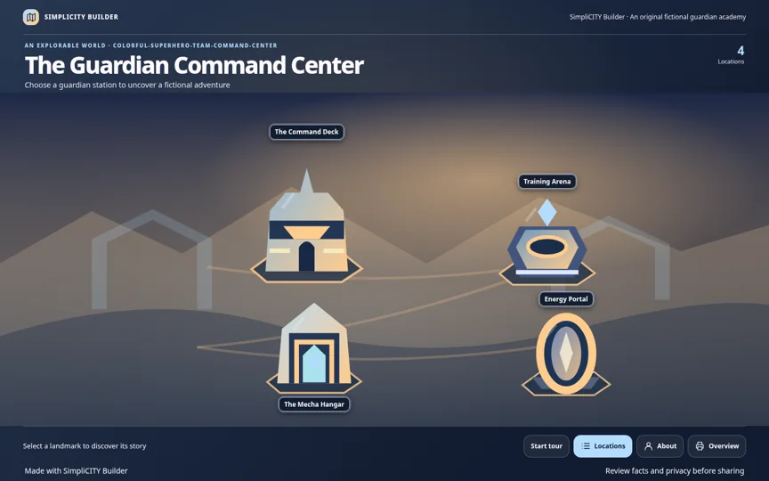

# SimpliCITY Builder ✦

**Your content. Your imagination. An interactive world.**

**Needs a chat or agent with code execution and file output; a text-only chat cannot run the generator.**

Give a compatible AI assistant a **photo, résumé, document, accessible link, or creative prompt**. Describe a world. Get a downloadable interactive HTML experience—not just a static image. Explore superhero headquarters, fantasy islands, exhibitions, science explainers and worlds that haven't been named yet.

**Version:** v0.2.0 implementation. The stable release tag should be created **only after external chat-host and visual acceptance**. [Installation](INSTALL.md) · [Live demo URL (verify Pages setup)](https://dishitkalsaria.github.io/SimpliCITY-Builder/) · [Testing](docs/maintainers/TESTING.md)




## Try it in a chat

**If the skill is installed:** Attach your source and send:

```text
SimpliCITY Builder: make me a world full of colorful superheroes. Résumé attached.
```

**If the skill is not installed:** Use a coding-capable chat and send these two lines:

```text
Fetch https://github.com/DishitKalsaria/SimpliCITY-Builder and follow AI_START_HERE.md (review the source before executing it).
Build and validate an interactive HTML experience from my attachment or link; give me the downloadable file. Do not publish.
```

The AI host must be able to read the source, retrieve the skill, run Python and return files. A URL alone **does not** install a skill; some chat products lack these abilities. The longer advanced prompt and trust rules are in [docs/LINK_ONLY.md](docs/LINK_ONLY.md). For an input without a specified theme, the skill asks **one short creative-world question**.

## Inputs and experiences

| Input | Example request | Result |
|---|---|---|
| Résumé | “Turn my career into a superhero command center.” | Source-grounded career world |
| Photo | “Let me explore this landscape.” | Actual supplied image with aligned, clickable observed objects |
| Document or PDF | “Make this report a futuristic museum.” | Clickable chapters, examples and key findings |
| Accessible link | “Turn this article into an interactive explainer.” | Source-grounded exhibit or explainer |
| Prompt alone | “Create an imaginary underwater academy.” | Clearly fictional interactive story |

Select **World**, **Explore** or **Explain** mode—or simply describe what you imagine. For non-fiction, the AI must read the content before creating factual descriptions. Photos require image understanding; links need retrieval; scanned PDFs may require OCR. No source access means **no invented source facts**.

## See it in action

| World | Demo site (requires Pages) | Fictional data |
|---|---|---|
| Fairytale kingdom | [Explore fairytale](https://dishitkalsaria.github.io/SimpliCITY-Builder/fairytale.html) | [JSON](examples/fairytale-sample.json) |
| Planets in space | [Explore space](https://dishitkalsaria.github.io/SimpliCITY-Builder/space.html) | [JSON](examples/space-sample.json) |
| Midnight festival | [Explore festival](https://dishitkalsaria.github.io/SimpliCITY-Builder/festival.html) | [JSON](examples/custom-sample.json) |
| Clockwork museum | [Explore clockwork](https://dishitkalsaria.github.io/SimpliCITY-Builder/clockwork.html) | [JSON](examples/clockwork-sample.json) |
| Guardian command center (new) | [Explore guardian](https://dishitkalsaria.github.io/SimpliCITY-Builder/guardian.html) | [JSON](simplicity-builder/examples/guardian-academy.json) |
| Synthetic photo exploration (new) | [Explore lakeside](https://dishitkalsaria.github.io/SimpliCITY-Builder/photo.html) | [JSON](simplicity-builder/examples/photo-sample.json) · [Synthetic image](simplicity-builder/examples/synthetic-lakeside.png) |

**v0.2.0 polish:** Labels are visible without hover and stay attached to their objects, and guided tours offer Start / Previous / Next / Exit. On phones, real photos use a context-preserving crop with blurred margins, object navigation, and a Fit photo control. Original image metadata is stripped before embedding; a private review-sheet option preserves evidence outside the public page.

The **HTML demos are committed under `docs/`**. Their public availability could not be confirmed from this development environment. If a link returns 404, enable GitHub Pages: **Settings → Pages → Deploy from a branch → `main` → `/docs` → Save**; then verify each URL. See [GITHUB_SETUP.md](docs/maintainers/GITHUB_SETUP.md). The screenshots above include a v0.2.0 superhero-world capture; a bespoke AI-created theme can look different.

## Install and run

Download `simplicity-builder.zip` from the **v0.2.0 GitHub Release after it is published**, then import the `simplicity-builder/` skill folder into a compatible code-executing AI assistant. Alternatively, install the folder into a supported agent's skills directory. Detailed instructions: [INSTALL.md](INSTALL.md). The ZIP includes the renderer, examples, validators, templates and optional browser checker; it does **not** require cloning this repository to run.

For developers, Python **3.9+**, standard library only. Photo mode requires `--source-image` plus host-observed `chapter.anchor` coordinates; it deliberately fails without either. See [photo schema](simplicity-builder/references/experience-schema.md).

```bash
python3 -m unittest discover -s tests -v
# Contributors: install requirements-dev.txt, then run scripts/ci_preflight.py all before pushing.
python3 simplicity-builder/scripts/build.py --input simplicity-builder/references/experience-sample.json --output demo.html
python3 simplicity-builder/scripts/check.py simplicity-builder/references/experience-sample.json demo.html
```

The same `build.py` and `check.py` commands automatically detect legacy résumé (`profile/world/sections`) or source-neutral (`source/experience/chapters`) JSON. For non-fiction experience items, a source excerpt or observed photo detail is required; optional private source text enables exact excerpt matching. Matching text is **not** proof of truth. [Schema reference](simplicity-builder/references/experience-schema.md) · [Résumé schema](simplicity-builder/references/portfolio-schema.md) · [Testing](docs/maintainers/TESTING.md)

## Artwork and interaction

**The illustration is the navigation.** Real source photos use normalized, object-anchored interactive regions, and the generator requires the actual image plus host-supplied object boxes—it cannot invent object locations or replace an absent photo with generic scenery. Landmarks have visible name plaques without hover. On cropped mobile photos, the focused region is labelled and the others remain discoverable through Previous/Next and the location list. One-item content receives a featured-story action. The procedural engine creates a separate mobile scene and uses theme-specific visual packs. Clickable, keyboard-focusable named SVG objects open details; the page does not rely on overlay pins. The offline generator has a procedural scene kit for multiple theme families, and coding-capable AI hosts can produce bespoke theme-specific SVG scenes. Authorized local photographs or host-generated artwork can be embedded where the host has the tools. **The generator does not contain an AI image model** and cannot promise photographic artwork in every chat environment.

We prioritize original art, recognizable composition, interesting silhouettes and scene-specific metaphors; no automatic use of copyrighted franchise logos, stock imagery or external image searches. For art direction and safety, see [art direction](simplicity-builder/references/art-direction.md), [visual QA](simplicity-builder/references/visual-quality.md), and [illustration rules](simplicity-builder/references/illustration-rules.md).

## Accessibility and visual quality

On desktop and mobile, primary navigation uses real named SVG shapes with keyboard focus, accessible labels and touch interaction, plus a searchable list as fallback. The page remains within the viewport; lengthy chapter details and the overview scroll **inside accessible dialogs**. Reduced-motion preferences and a print-friendly overview are supported. Visual polish still requires human screenshot inspection where browser tools are available; a green test suite alone does not certify WCAG conformance. High-contrast interface copy replaces earlier dim hints and credits. The optional Chromium smoke test now checks scene coverage, labels, target size, clipping, heading overflow and label contrast; screenshot-level art review still needs a human or a vision-capable agent.

## Privacy, accuracy and security

The uploaded source is handled under **the chosen AI host's privacy policies**. Core generation/validation does not upload files, request remote resources, use trackers or install remote fonts. The builder does **not** include private contact information by default. Factual descriptions must be traceable to the attached source; photo identities, résumé claims, research findings and quotes must not be invented. Original SVGs are sanitized to exclude scripts, links and remote images. Always inspect the generated page and its public links before publishing it. See [SECURITY.md](SECURITY.md).

## Publish and share (optional)

After reviewing all public information, `publish_portfolio.py prepare` creates a GitHub Pages folder, social-preview image and an editable LinkedIn caption **locally**. Deployment always requires separate approval and authorized GitHub access. LinkedIn hosts a preview/link, not the interactive HTML. [PUBLISHING.md](PUBLISHING.md).

## Repository guide

| Path | Purpose |
|---|---|
| [AI_START_HERE.md](AI_START_HERE.md) | Agent bootstrap for link + prompt |
| [simplicity-builder/SKILL.md](simplicity-builder/SKILL.md) | Portable chat-first Agent Skill |
| `simplicity-builder/references/` | Input schemas, grounding, art direction, privacy and publishing rules |
| `simplicity-builder/scripts/` | Unified `build.py` / `check.py`, backwards-compatible scripts, optional browser QA and publisher |
| `simplicity-builder/assets/template.html` | Accessible, offline single-file UI template |
| `simplicity-builder/examples/` | Fictional sample bundled with installable ZIP |
| `examples/` | Fictional résumé test inputs |
| `tests/` | Schema, SVG, security, publishing, portability and regression tests |
| `docs/` | GitHub Pages interactive gallery and screenshots |
| `.github/workflows/` | Test and tag-triggered release workflows |
| [COMPATIBILITY.md](COMPATIBILITY.md) | Verified vs. unverified AI host capabilities |
| [RELEASING.md](docs/maintainers/RELEASING.md) | Acceptance gates, tag, ZIP and checksum procedures |

## Privacy and visual quality safeguards

- **Photo privacy:** JPEG APP1/APP13, PNG EXIF/text, and WebP EXIF/XMP metadata are stripped in the standard-library path. Optional Pillow downsizes sources above 2000 px. Warn on large images; sanitized source max 10 MB and final HTML max 16 MB. Pixel data remains unchanged unless downscaling is requested by image dimensions.
- **Source accuracy:** For résumés, keep extracted source text privately and use `--source-text` by default when the host supports storage. `--review-sheet private/review.md` records item evidence, anchors, dates, numbers, and outstanding questions privately. **Passing checks does not prove factual accuracy.**
- **Interactive quality:** Plaques use collision-aware placement, safe bounds and distinct landmarks; landscape art fills the stage, portrait art is recomposed, and cropped mobile photography supports pan and Fit photo. Browser QA checks labels, clipping, coverage, contrast and controls.
- **Optional tools:** Playwright/Chromium for screenshots, locally supplied axe-core for accessibility audits, and Pillow for downscaling/golden comparisons. None is required to generate the baseline HTML.

Run from the installed skill folder:

```bash
python3 scripts/build.py --input /path/to/content.json --output /path/to/index.html --theme "desert ruins" --review-sheet /path/to/private/review.md
python3 scripts/check.py /path/to/content.json /path/to/index.html --source-text /path/to/private/source.txt
```

For visual regression baselines and optional axe checks, see [testing instructions](docs/maintainers/TESTING.md). The generated website is not automatically published; after reviewing facts, images and personal details, the owner may choose a separate [Publish & Share](PUBLISHING.md) step.

## Credits and license

Created and maintained by **[Dishit Kalsaria](https://github.com/DishitKalsaria)**, creator of the original [Simpli-City portfolio](https://dishitkalsaria.github.io/Simpli-City/). SimpliCITY Builder is the reusable Agent Skill; a separate SimpliCITY Studio platform is only a future possibility.

Released under the [MIT License](LICENSE). © 2026 Dishit Kalsaria. [Contributing](CONTRIBUTING.md) · [Changelog](CHANGELOG.md) · [Release acceptance](docs/maintainers/RELEASE_ACCEPTANCE.md) · [Engineering implementation report](docs/maintainers/V020_IMPLEMENTATION_REPORT.md).

