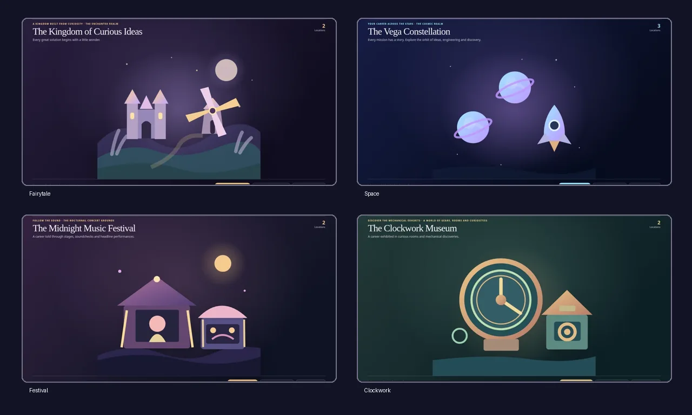

# SimpliCITY Builder ✦

**Your content. Your imagination. An interactive world.**

Turn a résumé, photo, document, accessible link or original prompt into a
**downloadable, self-contained interactive HTML world** using a coding-capable
AI host. The host must be able to read files, run Python and return artifacts;
a text-only chat cannot build or install the skill. No automatic publishing.

**Current candidate:** v0.2.1 (not tagged). The generator uses Python 3.9+
standard library only. Optional browser QA requires Chromium/Playwright.
[Installation](INSTALL.md) · [Security](SECURITY.md) · [Publishing](PUBLISHING.md)



## Try it in a chat

After installing the [`simplicity-builder/` skill](simplicity-builder/SKILL.md),
attach a source and ask:

> SimpliCITY Builder, turn my résumé into an original cartoon-style city.
> Give me the interactive HTML file. Do not publish it.

Alternatively, a coding-capable agent can fetch the repository and follow
[AI_START_HERE.md](AI_START_HERE.md). A link alone does not install a skill;
source documents are untrusted, and personal claims require factual review.
Photo mode needs the actual image and observed object coordinates, never
fabricated object detection.

## See it in action

These are **working HTML demos**, not screenshots. Pages links only work after
GitHub Pages has been configured and the candidate has been pushed. All sample
identities and stories are fictional.

| World | Interactive demo | Fictional data |
|---|---|---|
| Fairytale kingdom | [Explore](https://dishitkalsaria.github.io/SimpliCITY-Builder/fairytale.html) | [JSON](examples/fairytale-sample.json) |
| Space constellation | [Explore](https://dishitkalsaria.github.io/SimpliCITY-Builder/space.html) | [JSON](examples/space-sample.json) |
| Festival | [Explore](https://dishitkalsaria.github.io/SimpliCITY-Builder/festival.html) | [JSON](examples/custom-sample.json) |
| Clockwork museum | [Explore](https://dishitkalsaria.github.io/SimpliCITY-Builder/clockwork.html) | [JSON](examples/clockwork-sample.json) |
| Guardian command center | [Explore](https://dishitkalsaria.github.io/SimpliCITY-Builder/guardian.html) | [JSON](simplicity-builder/examples/guardian-academy.json) |
| Synthetic lakeside photo | [Explore](https://dishitkalsaria.github.io/SimpliCITY-Builder/photo.html) | [JSON](simplicity-builder/examples/photo-sample.json) |
| Volcanic atelier | [Explore](https://dishitkalsaria.github.io/SimpliCITY-Builder/volcanic.html) | [JSON](simplicity-builder/examples/volcanic-sample.json) |
| Original toon city | [Explore](https://dishitkalsaria.github.io/SimpliCITY-Builder/toon.html) | [JSON](simplicity-builder/examples/toon-sample.json) |
| Meeting room | [Explore](https://dishitkalsaria.github.io/SimpliCITY-Builder/meeting-room.html) | [JSON](simplicity-builder/examples/meeting-room-sample.json) |
| Playground | [Explore](https://dishitkalsaria.github.io/SimpliCITY-Builder/playground.html) | [JSON](simplicity-builder/examples/playground-sample.json) |
| Working farm | [Explore](https://dishitkalsaria.github.io/SimpliCITY-Builder/farm.html) | [JSON](simplicity-builder/examples/farm-sample.json) |

[Watch a short guided-tour recording](docs/assets/volcanic-tour.webm) captured
from the working volcanic HTML. Use it to show the actual interactive behavior,
not as a substitute for opening the website.

## v0.2.1 — visual-first artwork

**Preferred path:** A host capable of original SVG composition should author
**two safe layouts** (`scene_svg` and `scene_svg_mobile`) with themed architecture,
depth and light. Use the [scene-authoring contract](simplicity-builder/references/scene-authoring.md).
When the host can provide an approved cinematic *scenery-only* image, it can
embed the image under separately aligned interactive SVG landmarks. The
builder **does not generate images or infer their coordinates itself**.

**Fallback path:** A stdlib procedural engine now varies layout and terrain
across volcanic, space, ocean, guardian, toon, meeting-room, playground and farm families (plus other families).
Volcanic has crater/lava/embers; ocean has depth and reef shelves; space has
orbits; toon uses bold original comic shapes and heavy ink outlines. Meeting rooms use interior perspective and actual furnishings; playgrounds use recreational equipment; farms use agricultural structures. Content titles inform the object vocabulary. Dense 5–8 landmark worlds use safer layouts and compact phone labels. Procedural
SVG is functional offline art, not a guarantee of diffusion-grade illustration.

**Required when browser tools are available:** build → validate → render at
both desktop and mobile → inspect actual screenshots → revise up to two rounds.
The source, accessible HTML labels and touch/keyboard navigation remain real,
not baked into scenery. Visual review is a human acceptance gate.

## Build, validate, test

```bash
python3 simplicity-builder/scripts/build.py --input simplicity-builder/examples/volcanic-sample.json --output example.html
python3 simplicity-builder/scripts/check.py simplicity-builder/examples/volcanic-sample.json example.html
python3 scripts/check_environment_matrix.py  # requires Playwright + Chromium
python3 -m unittest discover -s tests -v
```

**Before pushing to `main`**, install `requirements-dev.txt` and run
`python scripts/ci_preflight.py all` so Ruff, mypy and tests match CI.
GitHub Actions additionally tests actual Chromium layouts, runs axe-core,
generates a visual contact sheet and compares eight screenshot baselines.
The browser/contact-sheet scripts are developer tools only; the installable
Skill ZIP stays self-contained and offline.

## Accuracy, accessibility and privacy

Generated worlds provide keyboard-focusable SVG landmarks, always-visible
name plaques, a searchable locations list, a guided tour, recruiter/overview
panels, reduced-motion support and responsive layouts. Private source excerpts
and résumé review notes must never be embedded in public output. A passed
validator does not certify semantic truth, photo object identification or
artistic quality. Only the owner authorizes publishing.

[Testing and screenshot approval](docs/maintainers/TESTING.md) ·
[Release acceptance](docs/maintainers/RELEASE_ACCEPTANCE.md) ·
[Schema references](simplicity-builder/references/experience-schema.md) ·
[Compatibility](COMPATIBILITY.md) · [Contributing](CONTRIBUTING.md) ·
[Changelog](CHANGELOG.md) · [License](LICENSE)

Created by [Dishit Kalsaria](https://github.com/DishitKalsaria) · MIT licensed.
