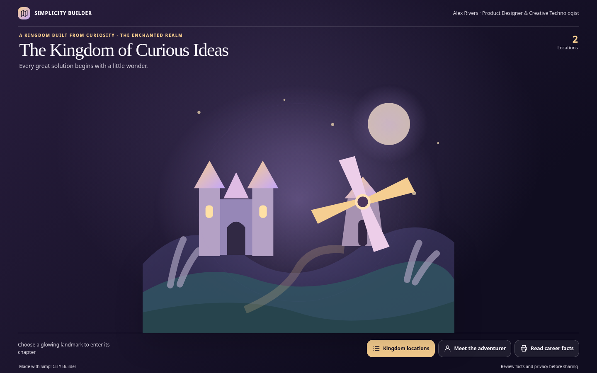

# SimpliCITY Builder ✦

**Your résumé tells your story. Your imagination builds its world.**

Turn an uploaded résumé and an imaginative prompt into a downloadable, explorable portfolio. Invent any world—a miniature solar system, fairy-tale kingdom, graffiti universe, floating library, undersea metropolis, surreal museum, or something nobody has imagined yet.

SimpliCITY Builder is a free, open-source **Agent Skill + small Python generator**. The result is a functional, responsive, offline `index.html` with discoverable places, search and detailed career stories—not just a rendered image.

> **Sample prompt:** “SimpliCITY, make me a city of planets in space.” *(Attach your résumé.)*

**[Explore the live fictional demo](https://dishitkalsaria.github.io/SimpliCITY-Builder/)** · **[Use without installing](#option-1-paste-the-link-and-prompt)** · **[Install the skill](#option-2-install-the-skill)** · **[Run tests](#testing-locally)**

> **Status: v0.1.0 public-beta candidate.** The generator is validated with fictional inputs. Cross-app résumé-upload-to-site acceptance testing remains a launch requirement. The live demo link becomes available after the repository is created and GitHub Pages is enabled.

## See what it builds



The [fictional fairytale demo](docs/index.html) is a generated *working page*. Other sample inputs demonstrate [space](examples/space-sample.json), [festival](examples/custom-sample.json) and [clockwork museum](examples/clockwork-sample.json) worlds. The visual theme can be **any user prompt**; these are only examples.

## Two ways to use it

### Option 1: Paste the link and prompt

In an AI assistant with **web/repository retrieval, résumé reading, file execution and downloadable output**, attach your résumé and paste:

```text
Read https://github.com/dishitkalsaria/SimpliCITY-Builder and follow AI_START_HERE.md and the linked SKILL.md. Use the repository's generator and template, not just the README. I've attached my résumé. SimpliCITY Builder, make me a floating city of planets in space. Produce and validate the working interactive index.html and give me the download. Keep my career facts accurate and my private contact details off the website.
```

Replace only the imaginative world phrase. **This is a best-effort entry point, not a universal one-click installation.** A text-only AI that cannot read a GitHub repository, run scripts or return files cannot complete the workflow from a link. See [link-only limitations](docs/LINK_ONLY.md).

### Option 2: Install the skill

For reliable repeat use, install or upload the [`simplicity-builder/`](simplicity-builder/) folder (or the skill ZIP attached to the GitHub release) to a compatible agent:

- **Claude:** Customize → Skills → Create skill → Upload a skill (where supported, with code execution enabled).
- **Claude Code:** copy `simplicity-builder/` to `.claude/skills/simplicity-builder/` for a project or `~/.claude/skills/simplicity-builder/` for a personal skill.
- **OpenAI Codex:** copy `simplicity-builder/` to `.agents/skills/simplicity-builder/` for a project or `~/.agents/skills/simplicity-builder/` globally.

Upload your résumé and say **“SimpliCITY Builder, make me a fairytale land.”** See [INSTALL.md](INSTALL.md) for detail.

## Testing locally

Python **3.9+** only; no pip requirements for generation. In the repository root:

```bash
python3 -m unittest discover -s tests -v
python3 simplicity-builder/scripts/build_portfolio.py --input examples/fairytale-sample.json --output fairytale-demo.html
python3 simplicity-builder/scripts/validate.py examples/fairytale-sample.json fairytale-demo.html
```

Open `fairytale-demo.html` in a browser. For another original world:

```bash
python3 simplicity-builder/scripts/build_portfolio.py --input examples/clockwork-sample.json --output clockwork-demo.html
```

## What can I customize?

The user controls the **world itself**. The AI extracts their real roles, skills, work, projects and education, then creates a thematic narrative, interactive region names, color scheme and optionally an original safe SVG scene. The generator supports any theme identifier, not a finite list of presets. The baseline output is **interactive 2D / 2.5D**, not a fully navigable bespoke 3D game. The résumé facts stay legible and accurate behind imaginative location names.

The generator doesn't parse PDFs by itself; the host AI does that. The skill doesn't deploy a website automatically or provide cloud storage. The downloadable HTML is offline and has no analytics or external dependencies.

## Repository guide

| Path | Purpose |
|---|---|
| [`AI_START_HERE.md`](AI_START_HERE.md) | Agent entry point for link + prompt |
| [`simplicity-builder/SKILL.md`](simplicity-builder/SKILL.md) | Installable portable Agent Skill |
| `simplicity-builder/references/` | Verified résumé schema and free-form world/illustration rules |
| `simplicity-builder/scripts/` | Generator and validator, standard-library Python |
| `simplicity-builder/assets/template.html` | Responsive one-file website template |
| `examples/` | Fictional test inputs, no personal résumés |
| `tests/` | Automated unit and safety validation |
| `docs/` | GitHub Pages fairytale demonstration |
| `.github/workflows/test.yml` | Tests run for pushes and pull requests |

## Privacy, accuracy and security

Résumé uploads remain subject to the **AI host's privacy policies**. The generator itself makes no network requests, and its output contains no tracker, remote fonts, or analytics. It does not include contact details by default. All facts must be traceable to the résumé; imaginative place names do not justify inventing credentials or achievements. The optional SVG artwork is sanitized against scripts and remote images. **Review the generated site and all public links before publishing it.**

See [SECURITY.md](SECURITY.md) for responsible issue reporting and [CONTRIBUTING.md](CONTRIBUTING.md) for contributions.

## Credits and future

Created and maintained by **[Dishit Kalsaria](https://github.com/dishitkalsaria)**, creator of the original [Simpli-City interactive portfolio](https://dishitkalsaria.github.io/Simpli-City/) ([source](https://github.com/dishitkalsaria/Simpli-City/)). This project is independent: the original portfolio remains the personal flagship, not an auto-generated template.

**SimpliCITY Builder** is the skill today. **SimpliCITY Studio** is a possible future self-service platform if interest, feedback and real usage justify it.

Released under the [MIT License](LICENSE). © 2026 Dishit Kalsaria.
